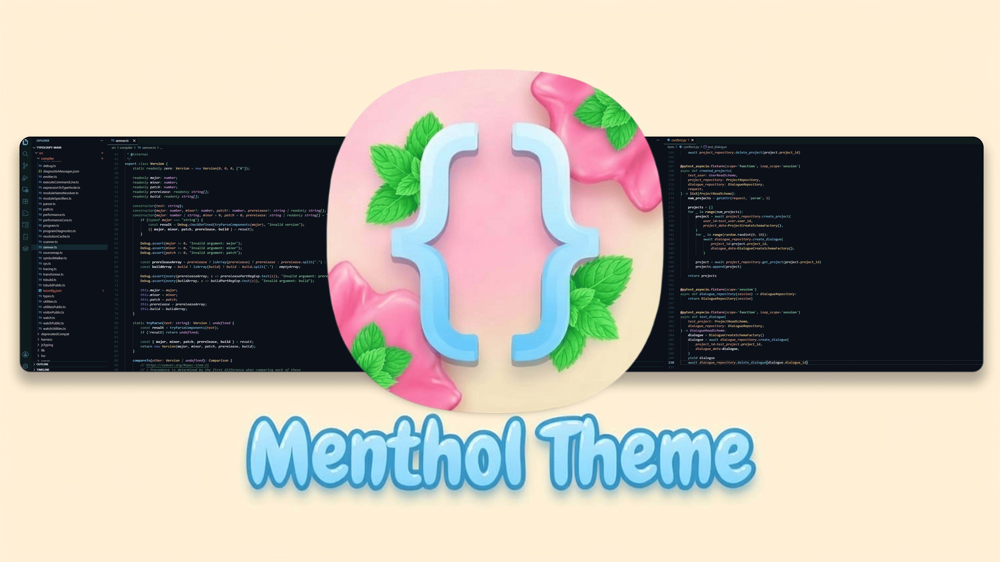

<div align="center">


# Menthol Theme

> Modern and minimalistic color theme for VS Code with mint accents and warm contrasting colors for focus, optimized for semantic highlighting across major programming languages.

[](https://marketplace.visualstudio.com/items?itemName=UltraKostik.vscode-menthol-theme)

[](https://open-vsx.org/extension/UltraKostik/vscode-menthol-theme)



</div>

---

## 🚀 Installation

### From VS Code Marketplace

1. Go to the [Menthol Theme page](https://marketplace.visualstudio.com/items?itemName=UltraKostik.vscode-menthol-theme) on the VS Code Marketplace.
2. Click the **"Install"** button.
3. After installation, open the Command Palette (`Ctrl+Shift+P` or `Cmd+Shift+P`).
4. Select **Preferences: Color Theme** and choose **Menthol Theme**.

For more details on selecting themes, see the [VS Code Color Theme documentation](https://code.visualstudio.com/docs/getstarted/themes#_selecting-the-color-theme).

### From GitHub (Manual Installation)

```bash
git clone https://github.com/UltraKostik/vscode-menthol-theme.git
cd vscode-menthol-theme
npm install
vsce package
```
Then in VS Code: Extensions view → `...` → **Install from VSIX...** → select the generated `.vsix` file.

## 🎨 Override This Theme

To customize this theme, you can override colors in your user or workspace settings. For example:

```json
{
  "workbench.colorCustomizations": {
    "[Menthol Theme]": {
      "editor.background": "#0A1118",
      "activityBarBadge.background": "#5AC8A8"
    }
  },
  "editor.tokenColorCustomizations": {
    "[Menthol Theme]": {
      "comments": "#5A9A7A"
    }
  }
}
```

Refer to the official guide on [customizing a color theme](https://code.visualstudio.com/docs/getstarted/themes#_customize-a-color-theme) for more advanced tweaks.

## 🤝 Contributing

I would be very happy to see your forks, improvements, and ideas! Feel free to:

- 🐛 Report bugs or suggest new features via [Issues](https://github.com/UltraKostik/vscode-menthol-theme/issues)
- 🔧 Submit pull requests with your enhancements
- 🌟 Star the repository if you like the theme

Let's make **Menthol Theme** better together!

**How to contribute:**

1. Fork the repository
2. Create a new branch: `git checkout -b feature/your-feature`
3. Make your changes
4. Commit: `git commit -m 'Add some feature'`
5. Push: `git push origin feature/your-feature'
6. Open a Pull Request

All contributions are welcome and appreciated! 🚀
